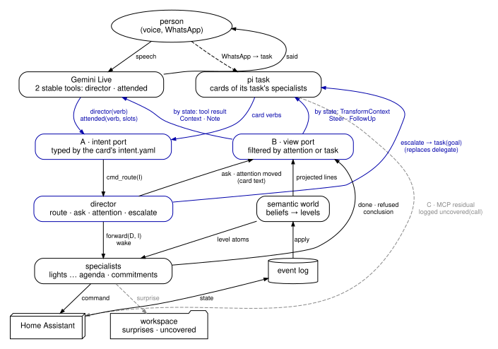

# Design: streamlining Nina's data flow around the director's two cards

Status: **proposal for review** (claudia → nina-lead, 2026-11-27). Companion documents:
[google-services.md](google-services.md) (the services inside the loop), the reasoning map
(https://claude.ai/artifact/JgtiCB4ttRBVcsWdxDyuBR, sources in `docs/diagrams/`), `ARCHITECTURE.md` §3–4
(flows F1–F7).

**The rule of this refactor: nothing merges unless it is measured, and nothing merges that regresses
what runs today.** It is the largest change Nina has had: it touches the voice's tools, the director's
rules, the task runner's start, and every way a result reaches either LLM. Section 6 is the
measurement plan; every step in section 5 names the metric that admits it.

## 1. Motivation

Nina's reasoning was built bottom-up: a tool or a Metis package was added each time a need showed
(nina-live), wired against Home Assistant. That gave tight domain connection. The top-down design
(nina-narratives: her two books formalised into rules) gives cross-domain behaviour, but its rules can
only act if the live system actually routes through them. Today it mostly does not:

- **The voice goes around the director.** Gemini Live is given all eleven `home_<pkg>` tools plus the
  read tools and `delegate`, fixed when the session opens (`cmd/nina/main.go` `voiceTools`). The voice
  picks the specialist itself; the director's rules (routing, attention, "the plant or the lamp?",
  re-route after a refusal, escalation) never see the choice.
- **Tasks start only from the LLM.** `delegate` (voice) and WhatsApp start pi tasks. A rule cannot:
  F4 (a conclusion's `task(goal, level)` starting a run) is designed and not wired.
- **Five couplings where three would do.** Verbs down, outcomes up, beliefs up, steering, MCP: each
  has its own path and filter, so the same conclusion reaches the voice and pi by different code.
- **MCP is a blind bypass.** pi's Home Assistant MCP calls change the home with no rule, no prediction
  and no surprise.

The user's assessment (2026-11-27): Nina does not use Metis reasoning fully, and the missing part is
full integration. This design is that integration, done so it can be measured.

## 2. Today (what runs, and must keep running)

| # | Coupling | Path |
|---|---|---|
| 1 | Verbs down | voice → `home_<pkg>(intent)` (one tool per package); pi → the same verbs |
| 2 | Outcomes up | a rule's done/refused is the tool's result; later outcomes as notes |
| 3 | Beliefs up | semantic world → level atoms → quantized port → voice Context/Note, pi TransformContext |
| 4 | Steering | a conclusion on a package a running task used → `Steer`; a late one → `FollowUp` |
| 5 | MCP | pi → Home Assistant Assist, ha-mcp (configuration work) |

## 3. Target: three channels

- **A · the intent port.** Every intent enters the rules as `cmd_route(I)` and passes the director.
  - The voice holds **two stable tools**: `director(verb, …)` (route, switch, status, stop, help,
    escalate) and `attended(verb, slots)`. The attended card's verbs and slots reach the voice as keyed
    silent context when attention moves; the intent port types the call against that card's
    `intent.yaml` and refuses with the card's words when it does not fit.
  - pi keeps per-card tools for the specialists its task attends (its tool list can change per request).
  - `delegate` becomes the director's **`escalate`**: a rule decides whether a goal is one specialist's
    verb (forward) or a task (`task(goal, level)` on its output port → `task created` → a pi run). This
    is F4, and it also gives rules their own way to start tasks.
- **B · the view port.** One adapter reads Metis's output port and the world's projection and delivers
  by the consumer's state:
  - voice: the tool's result while it waits for one; otherwise silent Context, or a Note by level;
  - pi: TransformContext before a request, Steer during a run, FollowUp at its end;
  - one filter for both: the attended specialist for the voice, the task's specialists for pi.
- **C · MCP as a measured residual.** pi may still call MCP servers for what no package covers; each
  call is logged as `uncovered(call)` into the Metis workspace. The share should fall as packages grow;
  the calls are input for F7 mining.

## 4. Gemini Live's constraint and the two-card variants

The Live API fixes tools at session setup; changing them means reconnecting with the resumption handle,
and Live may refuse to resume after a setup change (fsttm-live `internal/live/voice.go`). Two variants,
both measured before one is chosen:

- **V1, stable declarations (first):** the two tools never change; the attended card's text is context.
  Risk: the model forms slots from context less exactly than from a schema.
- **V2, swap on attention:** reconnect with the new card declared. Exact schemas; a reconnect per switch.

## 5. Steps (each admitted by section 6's gates)

| Step | Change | Where | Admitted when |
|---|---|---|---|
| 0 | **Real SITL with metrics** (nina-narratives runs `cmd/nina` itself: composition, semantic world, pi, tools; DeepSeek Flash on OpenRouter for volume) | nina-narratives `sitl/`, nina-live | baseline of today's flows recorded on a frozen scenario set, twice, within noise |
| 1 | **Two cards, V1** | nina-live `cmd/nina` voice tools, metis-agent orchestrator union (director + attended), catalog director card | routing ≥ baseline, goals met ≥ baseline, tokens per turn ↓ |
| 1b | V2 only if V1 misses on slots | fsttm-live voice | as 1, plus reconnect cost acceptable |
| 2 | **escalate replaces delegate (F4)** | catalog director rules, nina-live core (`task(goal)` port → tasks) | delegated goals' outcome ≥ baseline; no task storm (tasks per hour bounded) |
| 3 | **One view port** | nina-live core projection, tasks Steer/FollowUp/TransformContext, dialogue Context/Note | the same lines reach both LLMs (log diff); latency to first audio ≤ baseline |
| 4 | **MCP residual logged** | nina-live tasks (MCP tool wrapper), Metis workspace | every MCP call has an `uncovered` record; behaviour unchanged |
| 5 | Catalog reconciliation with nina-narratives' rulings (commitments, attention) | catalog, image.golden | the narratives' accepted rulings pass in the real SITL |

Steps 1–4 each land behind a config switch (`voice.cards: two|per_package`, `tasks.escalate`,
`view.port: one|legacy`, `mcp.residual_log`), so pero can run the old path while Pascal runs the new.

Step 3 landed without its switch (2026-11-28, `view/`). The one port delivers exactly what the three
paths did (the rules' replies, the world's changed lines, the services' observations, and the notes she
says on her own), so there is no old path to keep. Its log (stream `view`: each line, what the voice and
the tasks got) is the gate's "same lines reach both" check. The attended card's filter for the voice
waits for the cards (step 1's V1 did not pass).

## 6. Measurement plan

**Baseline first.** Before any step: run the frozen scenario set on today's code (main at the start of
the work, its commit recorded), at least twice, and keep the numbers as `sitl/baseline-<commit>.json`.
A metric's noise band is the spread of those runs.

**Metrics** (all from the event log, against the scenario's hidden truth):

| Group | Metric |
|---|---|
| Routing | intents reaching the right specialist; asks per intent; re-routes; `refused(route)` |
| Outcome | scenario goals met; surprises per scenario; refusals the person had to repair |
| Tasks | delegated goals completed; turns and tool calls per task; tasks per hour (F4 storm guard) |
| Cost | voice tool-declaration tokens per turn; tool calls per intent; time to first audio; reconnects |
| Coverage | share of pi's actions through MCP instead of a card |

**Gates.** A step merges only if no metric falls outside the baseline's noise band in the wrong
direction, and its own target metric improves. A regression stops the step; it is fixed or reverted,
never merged with a note.

**Regression suites that must stay green at every merge:** nina-live `./build.sh test ./...` (core rigs
with METISC, tasks, agenda, timers, world replay), fsttm-live's dialog tests, `metisc --link` certifying
the composition, the media test battery (subject s-21866507), and replay-equals-live.

**Live canary.** After SITL: Pascal runs the new path for a day with the old path available behind its
switch; pero follows only after Pascal's log shows no new error class and the same latency.

**Report per step:** the commit, the metrics table against the baseline, the gate's verdict. The series
of reports is the gradient of improvement the user asked for.

## 7. Open questions for nina-lead

1. The SITL drives `cmd/nina` as a process (panel API + a fake HA websocket) or links its packages?
2. One SITL for both books, or one per role (home, secretary)?
3. V1's card text as context: which part of the card (verbs and slot types only, or `intent.yaml`'s
   examples too)?
4. escalate's rule: what makes a goal a task rather than a forward (no candidate specialist, several,
   or a goal word list)?
5. Should the live surprise drop (wired, no surprise yet on Pascal) feed the same workspaces once the
   SITL is real?
